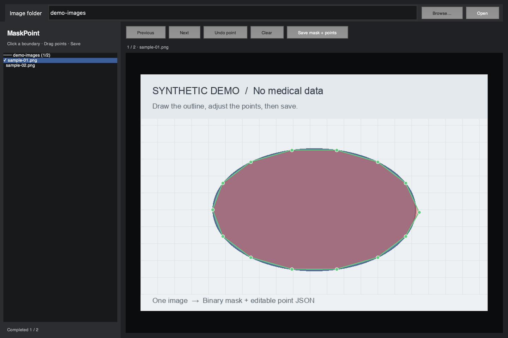

# MaskPoint

**Draw a polygon on an image. Drag its points. Save a binary mask and editable coordinates.**

MaskPoint is a lightweight **desktop image-annotation tool** for preparing binary image-segmentation datasets. You choose your own image folder, manually outline one object per image, and export the annotation at the original image resolution.

It runs locally with Python, Tkinter and Pillow — **no browser, server, account or AI model required**.

## Interface



*Actual running application with a generated, non-medical demo image. Green dots are editable polygon vertices; the red overlay shows the saved mask. No patient images or private datasets are included.*

## What you can do

- **Open your images:** type a folder path or use the native **Browse…** chooser.
- **Annotate an object:** click along its boundary, then drag points to refine the outline.
- **Save both formats:** a binary PNG mask for segmentation and a JSON file for reopening the editable polygon.
- **Track your progress:** navigate the image list and see which images have saved annotations.

## Installation and launch

### Requirements

- Python **3.10+** with a working **Tcl/Tk** installation.
- Pillow, installed by the command below.

```bash
git clone https://github.com/Lumilogoz/MaskPoint.git
cd MaskPoint
python -m pip install -r requirements.txt
python annotator.py
```

The app opens with an empty editor. You do **not** need to edit the Python source to configure your images.

> Tkinter is provided by your Python installation, not by `pip`. Some Linux distributions require `python3-tk`. On macOS, use a Python environment with working Tk support, such as a suitable Conda installation. The app has been tested locally on macOS; other operating systems have not been verified.

## Annotate your first image

1. **Choose a folder.** Paste the directory containing your images into **Image folder**, then click **Open** or press **Enter**. Alternatively, click **Browse…**.
2. **Select an image.** Pick it from the list on the left.
3. **Draw the outline.** Click around the object to add polygon vertices. Add at least three points.
4. **Adjust the boundary.** Click and drag an existing green dot. Use **Undo point** or **Clear** if needed.
5. **Save.** Click **Save mask + points** or press **S**. The app writes the PNG/JSON pair and displays the saved mask as a red overlay.
6. **Continue.** Use **Next**, **Previous**, or the image list. Saved point JSON is reloaded when you reopen an image.

> **Save before changing images.** Unsaved edits are not retained by Previous/Next or image-list navigation. Switching to another image folder asks for confirmation if there are unsaved polygon edits.

### Where to set the image path

Use the **Image folder** field at the top of the window. You can replace it and click **Open** at any time; no restart is needed.

You can also preload a folder from the terminal:

```bash
python annotator.py "/path/to/My Images"
```

- Replace `/path/to/My Images` with **your own image directory**, not an individual image file or the `labels/` folder.
- In the terminal, quote a path containing spaces. **Inside the app, paste the path without surrounding quotes.**
- `~` expands to your home directory; relative paths are resolved from the terminal's current working directory.
- A nonexistent, empty or unsupported folder shows an error without replacing the previously loaded folder.

## Inputs and saved files

Supported image formats: **JPG/JPEG, PNG, BMP, TIFF and WebP**.

### Simple folder

Select `my-images/`. Labels are saved next to the source images in its `labels/` subfolder:

```text
my-images/
├── sample-01.jpg
├── sample-02.jpg
└── labels/
    ├── sample-01.png
    └── sample-01.json
```

### Grouped dataset

You may select a parent directory whose immediate subfolders contain images. Each group gets its own `labels/` folder. A group can also use an `images/` subfolder:

```text
my-dataset/
├── group-a/
│   ├── images/
│   │   └── sample-01.jpg
│   └── labels/
│       ├── sample-01.png
│       └── sample-01.json
└── group-b/
    └── sample-02.jpg
```

The scan is limited to the selected folder and its immediate groups; it does not recursively search arbitrary nested datasets. Hidden files and annotation/archive/overlay folders are excluded.

### Output formats

| File | Contents |
|---|---|
| `labels/<image_stem>.png` | Single-channel `L` image at the original width and height: **0 = background, 255 = polygon interior**. |
| `labels/<image_stem>.json` | Image/mask filenames, original dimensions, `image_pixels` coordinate system and editable `[x, y]` vertices. |

Saving replaces the current image's existing PNG/JSON annotation pair; **the source image is never changed**. Both files are staged before replacement, with rollback on a caught replacement error. This is not a database transaction: keep backups against power loss or rollback failure.

## Controls

| Control | Action |
|---|---|
| **Open / Enter** | Load the folder entered in the path field. |
| **Browse…** | Choose and open an image folder. |
| **Left click** | Add a vertex, or select an existing vertex to drag. |
| **Drag** | Move a vertex; coordinates stay inside the image. |
| **Previous / Next** or **← / →** | Change images. |
| **Undo point / Z** | Remove the last point. |
| **Clear / C** | Clear the editable polygon. |
| **Save mask + points / S** or **double click** | Save both outputs; at least three points are required. |

Typing in the image-path field does not trigger annotation shortcuts.

## Scope and limitations

- **One polygon per image**, with one foreground class. No multi-class labels, multiple objects or holes.
- Manual annotation only: **no automatic segmentation, model training or medical diagnosis**.
- While drawing, the app shows a green outline and vertices, not a filled preview. A saved mask appears as a red overlay.
- A mask PNG alone cannot recover the original clicked points. Reopening an editable polygon requires its matching JSON.
- Duplicate image stems within one group, such as `sample.jpg` and `sample.png`, are rejected because their output filenames would collide.

## Regression check

```bash
python test_annotation.py
```

The check uses generated fixtures and a hidden Tk window. It covers folder input and switching, click/drag, binary masks, point JSON, save/reload, shortcut isolation and failed-save rollback. It does not modify a real dataset.

## License and privacy

The program and synthetic UI screenshot are published under the **[MIT License](LICENSE)**.

No real medical images, patient information, dataset annotations, model weights or account credentials are distributed with this repository. The software license does **not** grant rights to external images or datasets; use only data you are authorized to annotate.
